# CixCode Agent Runtime 第一阶段设计

> 文档状态：基础版已实现，后续能力按本设计扩展
> 已实现：PluginHost、Agent Loop、ToolRunner、OpenAI-compatible Provider、JSON 配置加载、Windows SEA 可执行文件、38 个自动化测试
> 待实现：TUI 插件、Memory 插件、Compression 插件、ContextPipeline
> 默认技术栈：TypeScript、Node.js 22.12+、OpenAI-compatible Chat Completions

## 1. 背景与目标

CixCode 的目标是构建一个最小、高性能、高度可扩展的 LLM 工具编排 Agent 运行时。第一阶段先打通最小闭环：

```text
用户输入 → 上下文插件处理 → LLM 生成 → 工具调用（可选）→ 结果回填 → LLM 生成 → 最终输出
```

本阶段交付一个可嵌入的运行时核心。核心不直接依赖任何具体 LLM、TUI、记忆或压缩实现，而是通过插件宿主装配这些能力。

### 1.1 建设目标

1. 建立稳定、可测试的 Agent Loop。
2. 建立统一的插件 Manifest、生命周期、注册和能力解析机制。
3. 将 LLM Provider 实现为插件，核心只依赖 Provider 端口。
4. 将 TUI 实现为插件，核心只输出事件，不依赖终端库。
5. 为记忆检索、上下文压缩等后续能力定义插件契约和稳定接入点。
6. 支持流式文本和原生 Tool Calling。
7. 支持取消、步数限制、工具超时和统一错误语义。
8. 为后续 MCP、多 Agent、会话持久化等能力保留清晰边界。

### 1.2 非目标

第一阶段暂不实现：

- 完整 TUI、Web UI 或 IDE 集成；当前只提供最小 Headless CLI，TUI 保留插件契约和参考实现。
- 会话持久化和长期记忆产品能力；只定义记忆插件契约。
- 多 Agent 协作。
- MCP 协议适配。
- 向量检索、RAG 和提示词模板系统。
- 工具并发执行。
- 多模态消息。
- 远程插件市场、第三方插件审核、进程沙箱和热重载。

## 2. 关键设计决策

| 决策 | 选择 | 原因 |
| --- | --- | --- |
| 开发语言 | TypeScript | 接口表达能力强，适合运行时和工具生态 |
| 运行时 | Node.js 22+ | 原生支持 `fetch`、`AbortSignal` 和异步迭代器 |
| 扩展机制 | 进程内插件宿主 | 统一装配 LLM、TUI、记忆、压缩等能力 |
| 插件契约 | Manifest + 生命周期 + 能力端口 | 支持发现、校验、初始化和释放 |
| 模型协议 | OpenAI-compatible Chat Completions 优先 | 覆盖范围广，便于后续替换 Provider |
| 通信方式 | 原生 HTTP + SSE | 减少 SDK 依赖，避免厂商锁定 |
| 工具调用 | 原生 Tool Calling | 不依赖提示词约定 JSON，降低解析错误 |
| 输出方式 | 流式事件 | TUI、API 和未来 UI 都以插件方式消费 |
| 工具执行 | 第一版串行 | 结果顺序明确，取消和错误处理简单 |
| 测试策略 | Fake Provider + Mock SSE + Fake Plugin | 核心测试稳定、快速、无需 API Key |
| 依赖策略 | 运行时依赖尽量少 | 符合最小运行时定位 |

### 2.1 为什么不直接使用 Agent 框架

Agent Loop 和插件装配是本项目最核心的能力，需要精确控制消息、工具调用、取消、重试、扩展顺序和事件语义。第一版自行实现一个小循环和一个小插件宿主，比引入大型框架更容易验证协议细节，也能避免后续被框架抽象限制。

### 2.2 为什么先支持 OpenAI-compatible 协议

该协议具有较高的实际覆盖率。第一版将它实现为内置参考插件，但 Provider 端口保持协议无关。未来接入 Anthropic 或其他协议时，只需新增插件，不修改 Agent Loop。

### 2.3 为什么插件不只用于 LLM

LLM、TUI、记忆和压缩具有不同的变化频率，但都需要一致的装配、配置、取消和故障语义。统一插件模型可以避免每增加一种能力就修改核心循环。

## 3. 总体架构与插件模型

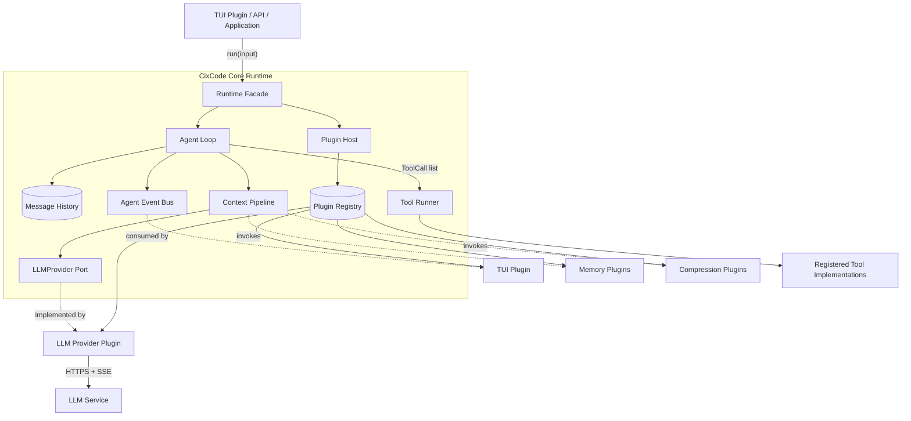

### 3.1 模块职责

| 模块 | 职责 |
| --- | --- |
| `core/types` | 消息、工具调用、LLM 事件、Agent 事件和结果类型 |
| `core/errors` | 统一错误分类与错误码 |
| `core/events` | Agent 事件分发和订阅 |
| `plugins/types` | Plugin Manifest、生命周期、配置和能力端口 |
| `plugins/host` | 插件校验、初始化、能力解析和释放 |
| `plugins/registry` | 保存已注册插件定义和实例 |
| `plugins/context-pipeline` | 按稳定顺序执行记忆和压缩插件 |
| `llm/provider` | 定义模型调用端口，不暴露厂商协议 |
| `llm/openai-compatible` | OpenAI-compatible Provider 参考插件 |
| `tui/types` | 定义 TUI 插件与 Runtime 之间的边界 |
| `tui/terminal` | 最小终端 TUI 参考插件 |
| `agent` | 管理消息、步骤、Usage、循环和对外事件 |
| `tools` | 参数校验、工具查找、执行、超时和结果格式化 |
| `runtime` | 创建运行时并装配插件 |
| `cli` | 提供 Headless 命令行入口、JSON 配置读取和事件输出 |
| `index` | 导出公共 API |

### 3.2 模块依赖规则

- `Agent` 只依赖 `LLMProvider`、`ContextPipeline` 和 `ToolRunner` 端口。
- `PluginHost` 负责把具体插件装配到这些端口。
- LLM 插件不依赖 `Agent`，只依赖核心消息和事件类型。
- TUI 插件只依赖 Runtime 门面和 Agent 事件，不依赖 Agent 内部实现。
- 记忆和压缩插件只依赖 `ContextPipeline` 定义的输入输出。
- 工具执行不依赖 LLM Provider。
- 公共类型位于核心模块，插件只能反向依赖核心，核心不能导入具体插件。

### 3.3 插件分类

| 插件类型 | 数量约束 | 职责 |
| --- | --- | --- |
| `llm-provider` | 恰好一个启用实例 | 创建 `LLMProvider`，负责模型协议和流式响应 |
| `tui` | 零个或一个启用实例 | 消费 Agent 事件并提交用户输入 |
| `memory` | 多个，按优先级执行 | 模型调用前检索记忆，模型调用后写入记忆 |
| `compression` | 多个，按优先级执行 | 在触发条件满足时压缩上下文 |
| `tool-provider` | 后续扩展 | 向 ToolRegistry 提供工具，不改变第一版核心循环 |

核心运行时必须强制校验启用实例的数量约束。例如同时启用两个 LLM Provider 时直接报错，不进行隐式选择。

### 3.4 插件架构图

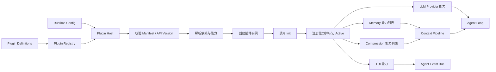

### 3.5 插件生命周期

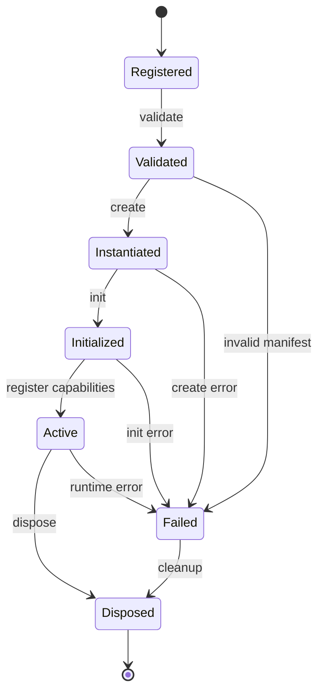

生命周期规则：

1. 所有插件必须先通过 Manifest 和 API Version 校验。
2. 实例化和 `init` 都接收统一的 `PluginContext`。
3. 只有 `init` 成功的插件才能注册能力。
4. 运行时关闭时先停止 TUI 和进行中的 Run，再按初始化逆序（即依赖逆序）调用 `dispose`。
5. 初始化失败的插件必须清理已创建资源。
6. 第一版不支持热重载和运行时替换必需插件。

### 3.6 插件核心契约

```ts
type PluginType =
  | "llm-provider"
  | "tui"
  | "memory"
  | "compression"
  | "tool-provider";

interface PluginManifest {
  id: string;
  type: PluginType;
  version: string;
  apiVersion: 1;
  entry?: string;
  dependencies?: string[];
  configSchema?: JSONSchema;
}

interface PluginContext {
  config: unknown;
  logger: Logger;
  signal: AbortSignal;
  services: PluginServices;
}

interface PluginServices {
  events: EventBus;
  registerTool(tool: Tool): void;
}

interface Plugin {
  readonly manifest: PluginManifest;
  init(context: PluginContext): Promise<void> | void;
  dispose(): Promise<void> | void;
}

interface PluginDefinition {
  manifest: PluginManifest;
  create(context: PluginContext): Promise<Plugin> | Plugin;
}
```

`PluginHost` 对外提供：

```ts
interface PluginHost {
  register(definition: PluginDefinition): void;
  load(configs: PluginConfig[]): Promise<void>;
  resolve<T>(type: PluginType): T;
  resolveAll<T>(type: PluginType): T[];
  dispose(): Promise<void>;
}
```

第一版插件以进程内 `PluginDefinition` 注册。Manifest 中的入口、依赖和配置 Schema 为后续外部插件加载预留，但第一版不执行远程代码加载。

### 3.7 LLM Provider 插件契约

```ts
interface LLMProviderPlugin extends Plugin {
  createProvider(): LLMProvider;
}
```

约束：

- `manifest.type` 必须为 `llm-provider`。
- 插件负责协议转换、SSE 解析和 Provider 级重试。
- Agent Loop 只看到统一的 `LLMEvent`。
- Provider 能力在运行时启动时解析一次，运行中不动态切换。

### 3.8 TUI 插件契约

```ts
interface TUIPlugin extends Plugin {
  attach(host: TUIHost): Promise<TUIHandle> | TUIHandle;
}

interface TUIHost {
  run(input: RunInput): AsyncIterable<AgentEvent>;
  subscribe(
    listener: (event: AgentEvent) => void | Promise<void>,
  ): () => void;
}

interface TUIHandle {
  start(): Promise<void> | void;
  stop(): Promise<void> | void;
}
```

TUI 插件可以：

- 订阅 `step-start`、`text-delta`、`tool-start`、`tool-end` 和 `done`。
- 调用 `host.run()` 提交用户输入。
- 独立实现输入框、历史记录、确认交互和终端渲染。

核心运行时不导入 Ink、Blessed 或其他终端库，也不包含 TUI 按键和布局逻辑。没有 TUI 插件时，运行时仍可通过 API 使用。

### 3.9 记忆与压缩插件契约

```ts
interface MemoryItem {
  id: string;
  content: string;
  metadata?: Record<string, unknown>;
}

interface MemoryQuery {
  query: string;
  messages: Message[];
  limit?: number;
}

interface MemoryWrite {
  messages: Message[];
  result: AgentResult;
}

interface MemoryPlugin extends Plugin {
  retrieve(
    query: MemoryQuery,
    context: HookContext,
  ): Promise<MemoryItem[]>;
  write(
    input: MemoryWrite,
    context: HookContext,
  ): Promise<void>;
}

interface CompressionInput {
  messages: Message[];
  estimatedTokens?: number;
  reason: "threshold" | "manual";
}

interface CompressionResult {
  messages: Message[];
  summary?: string;
  droppedMessages: number;
}

interface CompressionPlugin extends Plugin {
  shouldCompress(input: CompressionInput): boolean | Promise<boolean>;
  compress(
    input: CompressionInput,
    context: HookContext,
  ): Promise<CompressionResult>;
}

interface HookContext {
  signal: AbortSignal;
  logger: Logger;
  step?: number;
}
```

接入顺序：

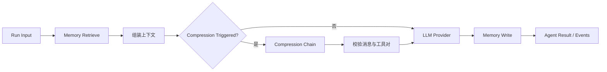

关键约束：

- 记忆插件按优先级升序检索，结果统一去重和格式化。
- 压缩插件按优先级升序串行执行。
- 压缩不能拆散 `assistant.toolCalls` 与对应 `tool` 消息。
- 记忆写入发生在一次 Run 完成后，不阻塞文本流式输出。
- 所有插件调用接收同一个取消信号和超时控制。

### 3.10 插件配置与故障策略

```ts
interface PluginConfig {
  id: string;
  type: PluginType;
  enabled?: boolean;
  priority?: number;
  config?: unknown;
}

interface RuntimeConfig {
  plugins: PluginConfig[];
  agent: AgentOptions;
}
```

故障策略：

| 插件 | 失败时行为 |
| --- | --- |
| `llm-provider` | 必需能力，初始化或调用失败时终止当前 Run |
| `tui` | 可选能力，加载失败时报告错误；Runtime 仍可 Headless 使用 |
| `memory` | 检索失败时不注入记忆；写入失败不影响已完成结果 |
| `compression` | 压缩失败时不发送不完整上下文，直接终止当前 Run |
| `tool-provider` | 单个工具注册失败不影响其他工具，但必须报告 |

第一版插件运行在同一进程内，视为受信任代码，不提供安全沙箱。后续如需加载第三方插件，必须增加进程隔离、权限声明和资源限制。

## 4. 核心数据模型

### 4.1 消息与工具调用

```ts
type Role = "system" | "user" | "assistant" | "tool";

interface Message {
  role: Role;
  content: string | null;
  toolCalls?: ToolCall[];
  toolCallId?: string;
  name?: string;
}

interface ToolCall {
  id: string;
  name: string;
  arguments: string;
}

interface ToolDefinition {
  name: string;
  description: string;
  parameters: JSONSchema;
}

interface ToolContext {
  signal: AbortSignal;
  toolCallId: string;
}

interface Tool {
  name: string;
  description: string;
  parameters: JSONSchema;
  execute(args: unknown, context: ToolContext): Promise<unknown>;
}
```

约束：

- 第一版消息内容只支持文本。
- `assistant.toolCalls` 保存模型生成的完整工具调用。
- `tool.toolCallId` 必须与对应 `assistant.toolCalls[].id` 一致。
- 工具参数以字符串保存，执行前解析为 JSON 并按 Schema 校验。
- 工具注册表是唯一允许执行的工具来源。

### 4.2 LLM 请求与事件

```ts
type FinishReason =
  | "stop"
  | "tool_calls"
  | "length"
  | "content_filter";

interface Usage {
  inputTokens: number;
  outputTokens: number;
  totalTokens: number;
}

interface LLMRequest {
  messages: Message[];
  tools?: ToolDefinition[];
  temperature?: number;
  maxTokens?: number;
}

type LLMEvent =
  | { type: "text-delta"; delta: string }
  | {
      type: "tool-call-start";
      index: number;
      id: string;
      name: string;
    }
  | {
      type: "tool-call-delta";
      index: number;
      argumentsDelta: string;
    }
  | { type: "tool-call-end"; index: number }
  | { type: "usage"; usage: Usage }
  | { type: "finish"; reason: FinishReason };
```

`index` 用于区分同一次响应中的多个工具调用。不同工具调用的参数片段可能交错到达，因此不能按到达顺序直接拼接。

### 4.3 Agent 事件与结果

```ts
type AgentEvent =
  | { type: "step-start"; step: number }
  | { type: "text-delta"; delta: string }
  | { type: "tool-start"; call: ToolCall }
  | {
      type: "tool-end";
      call: ToolCall;
      result: ToolExecutionResult;
    }
  | { type: "done"; result: AgentResult };

interface AgentResult {
  status: "completed" | "max_steps";
  messages: Message[];
  usage: Usage;
}

interface ToolExecutionResult {
  ok: boolean;
  content: string;
  error?: {
    code: string;
    message: string;
  };
}
```

错误语义：

- 正常完成和达到步数上限时发送 `done`。
- Provider 致命错误抛出 `AgentError`。
- 用户取消抛出 `AgentAbortedError`。
- 普通工具失败转换为工具结果，允许模型继续修正。

## 5. Agent Loop 设计

### 5.1 循环流程图

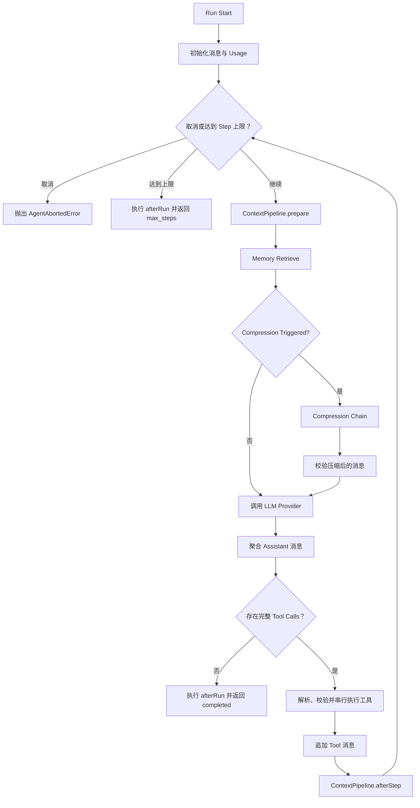

### 5.2 状态图

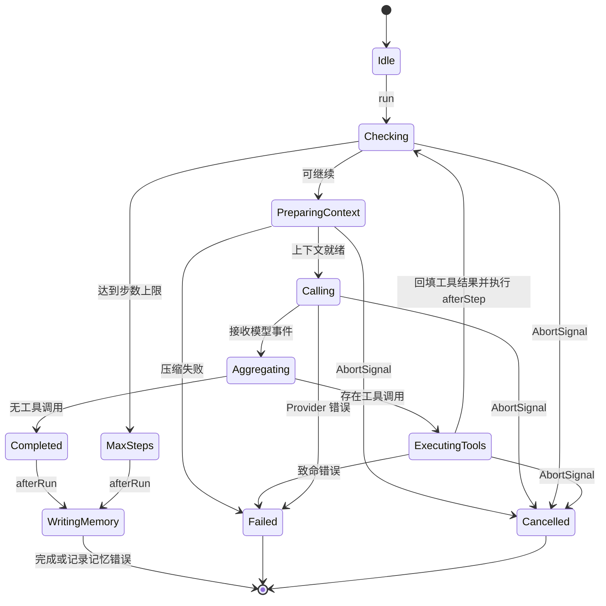

### 5.3 ContextPipeline 端口

```ts
interface ContextPipeline {
  prepare(input: PrepareContextInput): Promise<Message[]>;
  afterStep(input: AfterStepInput): Promise<void>;
  afterRun(input: AfterRunInput): Promise<void>;
}

interface PrepareContextInput {
  step: number;
  messages: Message[];
  signal: AbortSignal;
}

interface AfterStepInput {
  step: number;
  messages: Message[];
  assistant: Message;
  toolMessages: Message[];
  signal: AbortSignal;
}

interface AfterRunInput {
  messages: Message[];
  result: AgentResult;
  signal: AbortSignal;
}
```

`ContextPipeline` 由核心实现编排，记忆和压缩能力来自插件。Agent Loop 不直接导入记忆或压缩插件。

### 5.4 循环伪代码

```ts
async *run(input: RunInput): AsyncIterable<AgentEvent> {
  const messages = normalizeMessages(input.messages, systemPrompt);
  const usage = emptyUsage();
  const signal = input.signal ?? new AbortController().signal;

  const finish = async (
    status: "completed" | "max_steps",
  ): Promise<AgentResult> => {
    const result = { status, messages, usage };
    await contextPipeline.afterRun({ messages, result, signal });
    return result;
  };

  for (let step = 1; step <= maxSteps; step++) {
    throwIfAborted(signal);

    yield { type: "step-start", step };

    const preparedMessages = await contextPipeline.prepare({
      step,
      messages,
      signal,
    });

    const assistant: Message = {
      role: "assistant",
      content: "",
      toolCalls: [],
    };

    const request: LLMRequest = {
      model,
      messages: preparedMessages,
      tools: toolRunner.definitions,
      temperature,
      maxTokens,
    };

    for await (const event of provider.stream(request, signal)) {
      applyLLMEvent(assistant, usage, event);
      const agentEvent = toAgentEvent(event);
      if (agentEvent) yield agentEvent;
    }

    validateAssistantMessage(assistant);
    messages.push(assistant);

    if (assistant.toolCalls.length === 0) {
      yield { type: "done", result: await finish("completed") };
      return;
    }

    const toolMessages = await toolRunner.executeAll(
      assistant.toolCalls,
      signal,
    );

    messages.push(...toolMessages);

    await contextPipeline.afterStep({
      step,
      messages,
      assistant,
      toolMessages,
      signal,
    });
  }

  yield { type: "done", result: await finish("max_steps") };
}
```

### 5.5 关键不变量

1. 每一轮只追加一个完整 `assistant` 消息。
2. 工具调用完成后，必须按工具调用顺序追加对应 `tool` 消息。
3. 不完整的工具调用不允许执行。
4. 普通工具失败不终止循环。
5. Provider 已经输出部分内容后不自动重试。
6. 所有插件和异步操作接收同一个 `AbortSignal`。
7. Usage 只累计 Provider 实际报告的数据。
8. 记忆和压缩插件按优先级稳定执行，执行顺序可测试。
9. 压缩不能破坏工具调用与工具结果的配对关系。
10. 记忆写入失败不改变已经完成的 AgentResult。

## 6. 主流程时序图

### 6.1 运行时启动与文本完成

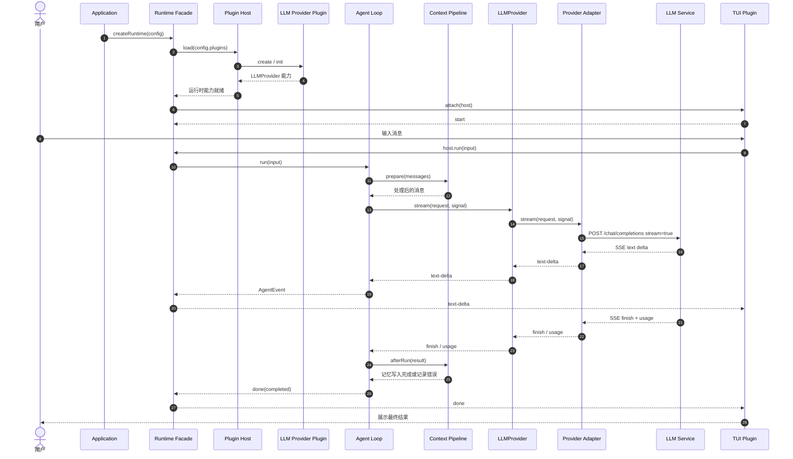

### 6.2 工具调用循环

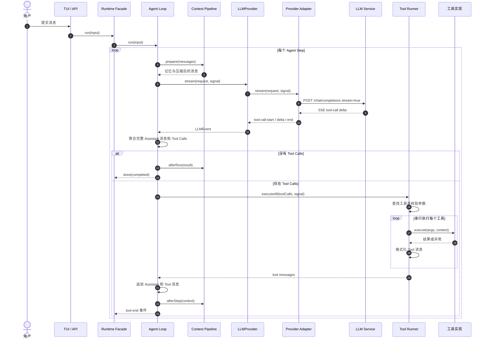

### 6.3 记忆与压缩插件时序

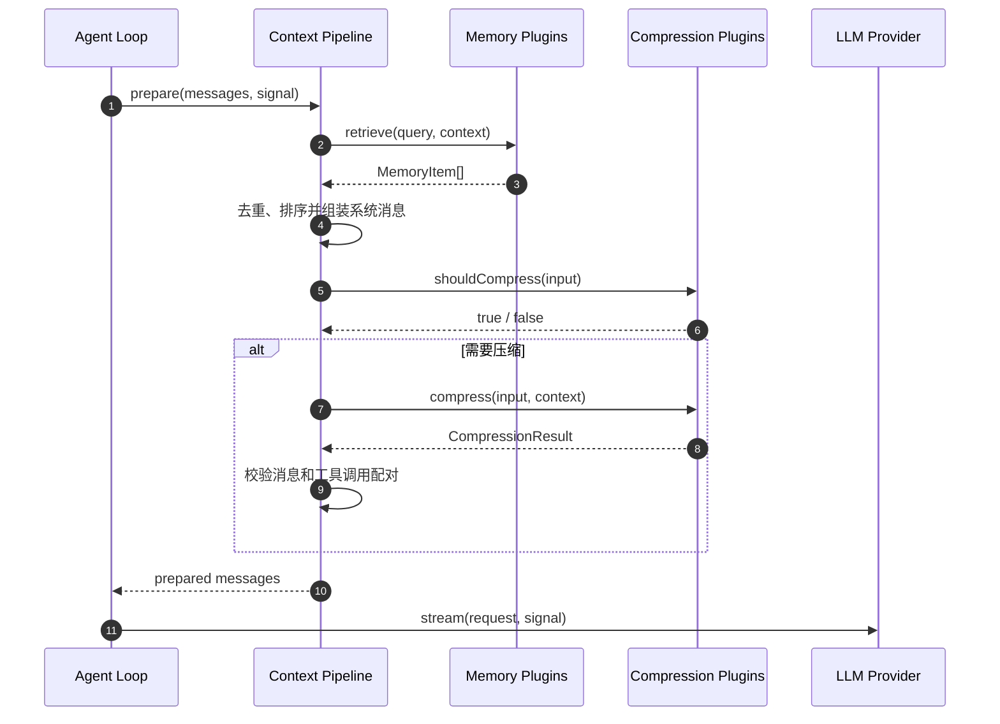

## 7. LLM Provider 插件设计

### 7.1 Provider 插件与端口

```ts
interface LLMProvider {
  readonly model: string;
  stream(
    request: LLMRequest,
    signal: AbortSignal,
  ): AsyncIterable<LLMEvent>;
}

interface LLMProviderPlugin extends Plugin {
  createProvider(): LLMProvider;
}
```

OpenAI-compatible 插件定义示例：

```ts
const openAICompatiblePlugin: PluginDefinition = {
  manifest: {
    id: "openai-compatible",
    type: "llm-provider",
    version: "0.1.0",
    apiVersion: 1,
    configSchema: {
      type: "object",
      required: ["baseUrl", "apiKey", "model"],
    },
  },

  create(context) {
    return new OpenAICompatiblePlugin(context.config);
  },
};
```

设计要点：

- 插件负责协议转换、SSE 解析和 Provider 级重试。
- Agent Loop 只看到统一的 `LLMEvent`。
- 即使未来支持非流式接口，也可以实现为一次性产出完整事件的异步迭代器。
- Provider 必须响应 `AbortSignal`。
- 插件初始化时必须验证配置和模型能力，不把配置错误延迟到首次请求。

### 7.2 OpenAI-compatible 请求映射

| 内部字段 | OpenAI-compatible 字段 |
| --- | --- |
| `model` | `model` |
| `messages` | `messages` |
| `tools` | `tools[].type = "function"` |
| `ToolDefinition.name` | `tools[].function.name` |
| `ToolDefinition.description` | `tools[].function.description` |
| `ToolDefinition.parameters` | `tools[].function.parameters` |
| `temperature` | `temperature` |
| `maxTokens` | `max_tokens` |
| 固定开启 | `stream = true` |
| 固定开启 | `stream_options.include_usage = true` |

请求示例：

```json
{
  "model": "example-model",
  "messages": [
    { "role": "user", "content": "查询北京天气" }
  ],
  "tools": [
    {
      "type": "function",
      "function": {
        "name": "get_weather",
        "description": "查询指定城市天气",
        "parameters": {
          "type": "object",
          "properties": {
            "city": { "type": "string" }
          },
          "required": ["city"]
        }
      }
    }
  ],
  "stream": true,
  "stream_options": {
    "include_usage": true
  }
}
```

### 7.3 SSE 聚合规则

1. `delta.content` 追加到文本缓冲区。
2. `delta.tool_calls` 按 `index` 存入 Map。
3. 同一个 index 的 `function.name` 只应首次出现，后续片段不重复拼接。
4. `function.arguments` 按接收顺序拼接。
5. `finish_reason` 非空时发送 `finish` 事件。
6. Usage 可能独立于 finish 到达，需要单独累计。
7. 收到 `[DONE]` 后结束流。
8. 如果流在没有 `finish` 事件的情况下异常结束，视为响应不完整并抛出 `ProviderResponseError`。

### 7.4 错误与重试

| 场景 | 行为 |
| --- | --- |
| 网络连接失败 | 最多重试 2 次 |
| HTTP 429 | 尊重 `Retry-After`，最多重试 2 次 |
| HTTP 5xx | 最多重试 2 次 |
| HTTP 401 / 403 | 不重试，转换为鉴权错误 |
| HTTP 4xx | 不重试，转换为请求错误 |
| 已输出 SSE 事件后失败 | 不重试，转换为流错误 |
| JSON 或 SSE 格式错误 | 转换为响应格式错误 |
| 用户取消 | 转换为 `AgentAbortedError` |

Provider 插件只重试“尚未向调用方输出任何事件”的请求，避免重复文本和工具调用。

## 8. 工具执行设计

### 8.1 执行流程

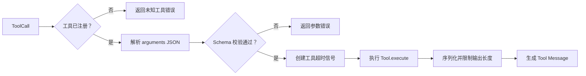

### 8.2 工具结果格式

成功结果：

```json
{
  "role": "tool",
  "toolCallId": "call_123",
  "name": "get_weather",
  "content": "{\"ok\":true,\"data\":{\"city\":\"北京\",\"weather\":\"晴\"}}"
}
```

失败结果：

```json
{
  "role": "tool",
  "toolCallId": "call_123",
  "name": "get_weather",
  "content": "{\"ok\":false,\"error\":{\"code\":\"TOOL_EXECUTION_FAILED\",\"message\":\"service unavailable\"}}"
}
```

### 8.3 执行约束

- 工具名称必须在注册表中唯一。
- 参数必须先解析为 JSON，再通过 JSON Schema 校验。
- 单工具默认超时 30 秒。
- 工具输出默认限制 16,000 字符，超出时截断并标记。
- 第一版串行执行，保证消息顺序确定。
- 工具可以由调用方直接注册，也可以由 `tool-provider` 插件通过 `PluginServices.registerTool` 注册。
- 工具超时通过 `AbortSignal` 尽力取消；工具必须配合检查信号。
- 不允许通过模型动态加载模块、执行 Shell 或访问任意路径。

## 9. 配置设计

### 9.1 Runtime 配置

```ts
interface RuntimeConfig {
  plugins: PluginConfig[];
  agent: AgentOptions;
}

interface AgentOptions {
  tools?: Tool[];
  systemPrompt?: string;
  maxSteps?: number;
  toolTimeoutMs?: number;
  maxToolOutputChars?: number;
  logger?: Logger;
}

interface RunInput {
  messages: Message[];
  signal?: AbortSignal;
}
```

`AgentOptions` 不直接接收具体 Provider。Provider、TUI、记忆和压缩实现由 `PluginHost` 根据 `plugins` 配置装配。

默认值：

| 配置 | 默认值 |
| --- | --- |
| `maxSteps` | 10 |
| `toolTimeoutMs` | 30,000 ms |
| `maxToolOutputChars` | 16,000 |
| `systemPrompt` | 无 |

### 9.2 插件配置

```ts
interface PluginConfig {
  id: string;
  type: PluginType;
  enabled?: boolean;
  priority?: number;
  config?: unknown;
}
```

配置示例：

```ts
const llm = await loadLLMConfig();
const config: RuntimeConfig = {
  plugins: [
    {
      id: "openai-compatible",
      type: "llm-provider",
      config: llm,
    },
    {
      id: "terminal",
      type: "tui",
      config: {},
    },
    {
      id: "conversation-memory",
      type: "memory",
      priority: 100,
      config: {},
    },
    {
      id: "token-threshold-compression",
      type: "compression",
      priority: 100,
      config: {
        threshold: 12000,
      },
    },
  ],
  agent: {
    tools: [getWeatherTool],
    maxSteps: 8,
  },
};
```

第一版要求：

- 每个配置项的 `id` 唯一。
- `type` 必须与插件 Manifest 一致。
- `config` 必须通过插件声明的 `configSchema` 校验。
- 未启用的插件不实例化。
- 记忆和压缩插件按 `priority` 升序执行。

当前基础版内置 OpenAI-compatible Provider 插件；Terminal TUI、Memory 和 Compression 为后续插件，配置示例用于展示统一装配方式。

### 9.3 OpenAI-compatible 插件配置

```ts
interface OpenAICompatibleProviderOptions {
  baseUrl: string;
  apiKey: string;
  model: string;
  defaultHeaders?: Record<string, string>;
  maxRetries?: number;
}
```

CLI 默认从用户目录下的 `~/.cixcode/settings.json` 读取配置：

```json
{
  "llm": {
    "baseUrl": "https://api.openai.com/v1",
    "apiKey": "your-api-key",
    "model": "gpt-4o-mini"
  }
}
```

`loadLLMConfig()` 校验文件读取、JSON 格式和必需字段，并返回插件可直接使用的 `LLMConfig`。配置文件位于用户目录，不进入项目仓库；API Key 不进入日志，也不会嵌入 SEA 可执行文件。

## 10. 错误模型

```ts
type ErrorCode =
  | "PLUGIN_MANIFEST_INVALID"
  | "PLUGIN_API_VERSION_MISMATCH"
  | "PLUGIN_DEPENDENCY_MISSING"
  | "PLUGIN_INIT_FAILED"
  | "PLUGIN_CAPABILITY_CONFLICT"
  | "PLUGIN_HOOK_FAILED"
  | "PROVIDER_AUTH_FAILED"
  | "PROVIDER_RATE_LIMITED"
  | "PROVIDER_REQUEST_FAILED"
  | "PROVIDER_RESPONSE_INVALID"
  | "PROVIDER_STREAM_FAILED"
  | "MEMORY_RETRIEVE_FAILED"
  | "MEMORY_WRITE_FAILED"
  | "CONTEXT_COMPRESSION_FAILED"
  | "TUI_ATTACH_FAILED"
  | "AGENT_ABORTED"
  | "AGENT_CONFIG_INVALID"
  | "TOOL_NOT_FOUND"
  | "TOOL_ARGUMENTS_INVALID"
  | "TOOL_TIMEOUT"
  | "TOOL_EXECUTION_FAILED";
```

错误处理原则：

- 插件 Manifest、API Version 和配置错误在运行时启动时立即失败。
- 必需插件初始化失败时终止启动。
- 可选插件初始化失败时报告错误，不阻塞 Headless 运行。
- Provider 调用错误由插件转换为统一 `AgentError`。
- 记忆检索或写入失败按插件故障策略处理，并记录明确错误。
- 压缩失败时不发送不完整上下文，直接终止当前 Run。
- 工具查找、参数和执行错误通常作为工具结果返回给模型。
- 错误对象保留 `cause`，但不记录请求头、API Key 或敏感插件配置。

## 11. 可观测性

### 11.1 事件

Agent 对外事件覆盖：

- Step 开始。
- 文本增量。
- 工具调用开始和结束。
- 最终结果。

TUI 插件订阅这些事件并独立完成渲染。API 插件或上层应用也可以直接消费相同事件，不依赖终端实现。

### 11.2 插件与运行日志

建议记录：

- `runtimeId`
- `pluginId`
- `pluginType`
- 插件状态与初始化耗时
- `runId`
- `step`
- `provider`
- `model`
- 请求耗时
- 工具名称与耗时
- 记忆检索与写入耗时
- 压缩前后消息数量和 Token 估算
- Token Usage
- 最终状态
- 错误码

默认不记录完整提示词、工具参数、工具输出和敏感插件配置。需要调试时由调用方显式开启。

### 11.3 指标

第一阶段至少提供：

- 插件加载成功/失败计数。
- Agent Run 成功/失败/取消计数。
- Provider 请求延迟和错误率。
- 工具执行延迟和失败率。
- 记忆插件延迟和失败率。
- 压缩触发次数和耗时。
- Token Usage。

具体 Exporter 由后续插件或上层应用实现，核心只提供稳定数据。

## 12. 安全设计

1. API Key 仅通过受控配置文件或调用方配置注入。
2. 日志脱敏 Authorization Header 和敏感配置字段。
3. 插件配置必须通过 Manifest 中的 JSON Schema 校验。
4. 第一版只加载进程内受信任插件，不提供远程代码加载。
5. 插件 API Version 不匹配时拒绝加载。
6. 工具必须显式注册，插件只能通过 `PluginServices.registerTool` 注册。
7. 模型生成的工具参数视为不可信输入。
8. 工具参数执行 JSON Schema 校验。
9. 限制工具输出长度，避免上下文膨胀。
10. 第一版不提供任意 Shell、动态代码执行或任意文件访问工具。
11. TUI 插件不得把模型输出直接作为终端控制序列或 Shell 命令执行。
12. 后续加载第三方插件时，必须增加进程隔离、权限声明和资源限制。

## 13. 测试策略

### 13.1 单元测试

| 模块 | 测试重点 |
| --- | --- |
| 核心类型与消息规范化 | 角色、系统提示词、工具消息顺序 |
| 配置加载 | 文件缺失、JSON 格式、必需字段、空白值 |
| Plugin Host | Manifest、API Version、依赖、生命周期、能力冲突 |
| OpenAI Provider 插件 | 请求映射、SSE 解析、增量聚合、错误转换 |
| Context Pipeline | 插件顺序、记忆注入、压缩触发、取消 |
| Agent Loop | 单轮完成、工具循环、Usage、Step 限制 |
| Tool Runner | 工具查找、参数校验、异常、超时、截断 |
| TUI 契约 | 事件订阅、输入提交、启动和停止 |
| 取消 | Provider、记忆、压缩和工具执行中取消 |

### 13.2 Fake Provider 与 Fake Plugin

测试中使用脚本化 Provider：

```ts
class FakeProvider implements LLMProvider {
  async *stream(
    request: LLMRequest,
    signal: AbortSignal,
  ): AsyncIterable<LLMEvent> {
    // 根据预设脚本产出事件
  }
}
```

Fake Provider 可以精确控制：

- 文本片段边界。
- 多个工具调用交错到达。
- 缺失 finish 事件。
- Provider 中途异常。
- Usage 报告顺序。
- 取消时机。

记忆和压缩测试使用 Fake Plugin：

```ts
class FakeMemoryPlugin implements MemoryPlugin {
  manifest = memoryManifest;

  async retrieve(): Promise<MemoryItem[]> {
    return [{ id: "memory-1", content: "用户偏好中文回答" }];
  }

  async write(): Promise<void> {}

  init(): void {}
  dispose(): void {}
}
```

### 13.3 插件宿主必测场景

1. 正常注册、初始化、激活和释放。
2. 重复插件 ID。
3. API Version 不匹配。
4. 依赖插件缺失。
5. 同时启用多个 LLM Provider。
6. 插件 `init` 抛异常并清理资源。
7. 可选插件失败后 Headless Runtime 仍可启动。
8. 释放顺序与初始化顺序相反。
9. 记忆和压缩插件按优先级执行。
10. 插件取消信号正确传递。

### 13.4 Agent 与工具必测场景

1. 用户消息后直接得到最终回答。
2. 单工具调用后生成最终回答。
3. 多工具调用且结果顺序正确。
4. 工具参数 JSON 损坏。
5. 工具未注册。
6. 工具执行抛异常。
7. 工具超时。
8. Provider 流中途断开。
9. 用户取消。
10. 达到 `maxSteps`。
11. Usage 跨步骤累计。
12. 记忆检索结果正确注入。
13. 记忆写入失败不改变 AgentResult。
14. 压缩失败时终止当前 Run。
15. 压缩不破坏工具调用与工具结果配对。
16. API Key 和敏感插件配置不出现在日志中。

### 13.5 集成测试

提供一个由 `~/.cixcode/settings.json` 控制的真实模型 Smoke Test，默认跳过。测试运行时通过插件宿主加载真实 OpenAI-compatible Provider，并使用 Fake TUI、Fake Memory 和 Fake Compression。

真实 Smoke Test 验证：

- 插件 Manifest 和配置校验。
- 鉴权与基础连接。
- 流式文本。
- 一个简单工具调用。
- 运行时释放。

真实 API 测试不进入每次本地开发的强制测试路径。

### 13.6 插件契约测试

每个新插件都必须实现同一套契约测试：

- 是否声明正确的 `type`。
- 是否响应取消信号。
- 是否把外部错误转换为统一错误。
- 是否在 `dispose` 中释放资源。
- 是否泄露内部配置或 API Key。
- 是否修改不属于自己的消息或工具注册表。

## 14. 目录结构与公共 API

### 14.1 建议目录

```text
src/
  index.ts
  runtime.ts
  cli.ts
  core/
    types.ts
    errors.ts
    events.ts
  plugins/
    types.ts
    host.ts
    registry.ts
    context-pipeline.ts
  llm/
    provider.ts
    openai-compatible/
      index.ts
      plugin.ts
      provider.ts
      sse.ts
  tui/
    types.ts
    terminal/
      index.ts
      plugin.ts
  agent/
    agent.ts
    tool-runner.ts

tests/
  config.test.ts
  core/
    events.test.ts
  plugins/
    host.test.ts
    registry.test.ts
    context-pipeline.test.ts
  llm/
    openai-compatible.test.ts
  tui/
    terminal.test.ts
  agent/
    agent.test.ts
    tool-runner.test.ts

scripts/
  smoke.ts
  terminal-smoke.ts
  build-sea.mjs
  smoke-exe.mjs

sea-config.json
```

### 14.2 公共 Runtime API

```ts
interface CixRuntime {
  readonly events: EventBus;
  run(input: RunInput): AsyncIterable<AgentEvent>;
  dispose(): Promise<void>;
  plugins: PluginHost;
}

declare function createRuntime(
  config: RuntimeConfig,
): Promise<CixRuntime>;
```

### 14.3 运行入口

```ts
const llm = await loadLLMConfig();
const runtime = await createRuntime({
  plugins: [
    {
      id: "openai-compatible",
      type: "llm-provider",
      config: llm,
    },
  ],
  agent: {
    tools: [getWeatherTool],
    maxSteps: 8,
  },
});

process.on("SIGINT", () => {
  void runtime.dispose();
});
```

Headless 使用时不配置 TUI 插件，直接消费事件：

```ts
for await (const event of runtime.run({
  messages: [
    { role: "user", content: "查询北京天气" },
  ],
})) {
  switch (event.type) {
    case "text-delta":
      process.stdout.write(event.delta);
      break;
    case "tool-start":
      console.log(`执行工具：${event.call.name}`);
      break;
    case "done":
      console.log(event.result.status, event.result.usage);
      break;
  }
}

await runtime.dispose();
```

### 14.4 Windows 可执行文件打包

`src/cli.ts` 是独立于公共库 API 的薄适配层：读取命令行或标准输入，从用户目录的 `~/.cixcode/settings.json` 读取 Provider 配置，消费 Runtime 事件并输出文本和工具状态。打包逻辑不进入 Agent 核心。

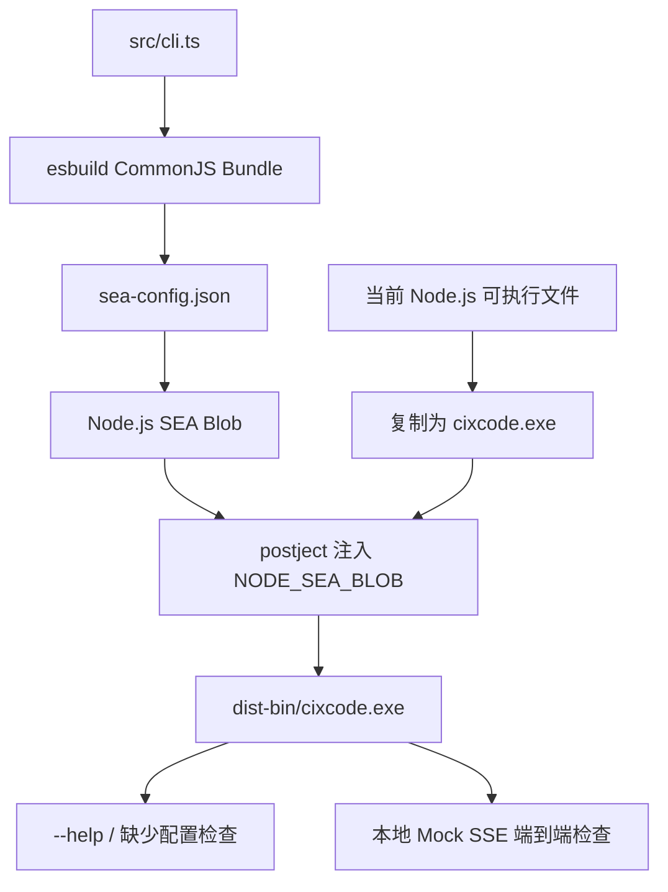

构建与验证命令：

```bash
npm run build:exe
npm run test:exe
```

实现约束：

1. 使用 `esbuild` 将 CLI 和运行时依赖打包为 CommonJS，避免 SEA 加载外部模块。
2. 使用 `node --experimental-sea-config sea-config.json` 生成 SEA Blob。
3. 以 `process.execPath` 作为基底，保证可执行文件与构建机器的 Node.js 版本及 CPU 架构一致。
4. 使用 `postject` 注入 `NODE_SEA_BLOB` 并设置 SEA sentinel fuse。
5. `scripts/smoke-exe.mjs` 启动本地 OpenAI-compatible SSE 服务，验证完整的模型请求、工具执行、工具结果回填和最终回答。
6. API Key 只通过外部 JSON 配置文件读取，不写入二进制；生成文件默认未做 Authenticode 签名，分发前可单独接入签名流程。

## 15. 实施里程碑

### M1：核心骨架与插件契约

- 初始化 TypeScript、ESM 和 Vitest。
- 定义消息、工具、Provider、Agent 事件和插件类型。
- 实现 PluginRegistry 基础结构。
- 确定公共导出边界。

验收：项目可以构建，插件契约类型检查通过。

### M2：插件宿主与 LLM Provider 插件

- 实现 PluginHost 和生命周期管理。
- 实现 OpenAI-compatible Provider 插件。
- 实现 SSE 解析和工具调用聚合。
- 增加 Plugin Host 与 Mock Fetch 测试。

验收：Runtime 可以通过插件配置解析出唯一 LLM Provider，且不依赖真实 API 完成测试。

### M3：Agent Loop、工具与上下文管线

- 实现 Agent Loop。
- 实现 ToolRegistry 和 ToolRunner。
- 实现 ContextPipeline。
- 使用 Fake Memory 和 Fake Compression 验证接入点。
- 支持取消、Step 限制、工具超时和结果截断。

验收：完整打通“上下文插件 → 模型 → 工具 → 模型”的最小闭环。

### M4：TUI 参考插件与加固

- 实现最小 Terminal TUI 插件。
- 增加 Headless 和 TUI 冒烟入口。
- 增加真实模型可选 Smoke Test。
- 补充插件错误、日志、安全和释放语义。

验收：同一个 Runtime 可以在 Headless 和 Terminal TUI 两种方式下运行，切换方式不修改 Agent Loop。

### M5：Windows 独立可执行文件

- 增加 Headless CLI 入口和 JSON 配置文件读取。
- 使用 esbuild 与 Node.js SEA 打包运行时和依赖。
- 使用 postject 生成 `dist-bin/cixcode.exe`。
- 增加帮助、配置错误和本地 Mock SSE 端到端冒烟检查。
- 记录可执行文件架构绑定与代码签名注意事项。

验收：目标机器无需安装 Node.js 即可运行 `cixcode.exe --help`，并通过一次完整工具调用冒烟测试。

## 16. 风险与权衡

| 风险 | 影响 | 应对 |
| --- | --- | --- |
| OpenAI-compatible 实现存在差异 | 流式工具调用行为不一致 | 使用 Mock SSE 建立协议测试，真实 Smoke Test 验证 |
| 部分 Provider 不完整支持 Tool Calling | 无法完成工具循环 | Provider 声明能力，Runtime 启动时检查 |
| 插件 API 过早稳定 | 后续扩展困难 | 第一版只暴露必要契约，并保留 `apiVersion` |
| 插件初始化失败 | 部分能力不可用 | 必需插件终止启动，可选插件明确报告 |
| 进程内插件缺乏隔离 | 第三方插件可能影响主进程 | 第一版仅加载受信任插件，沙箱列为后续能力 |
| 插件执行顺序不确定 | 记忆或压缩结果不可复现 | 使用显式优先级和稳定排序 |
| 串行工具执行性能有限 | 多工具场景延迟较高 | 第一阶段保证正确性，后续按工具副作用语义引入并发 |
| 流式重试可能重复输出 | 文本或工具调用重复 | 已输出事件后禁止自动重试 |
| 工具或插件输出过大 | Token 膨胀和延迟增加 | 默认截断并标记 |
| 无会话持久化 | 进程重启后上下文丢失 | 第一阶段接受，后续通过记忆或 SessionStore 插件扩展 |
| 模型参数不可信 | 安全风险 | Schema 校验、显式工具注册、最小权限 |

## 17. 后续扩展方向

1. 新增 Anthropic、Gemini 或本地推理 Provider 插件。
2. 增加非流式 Provider 插件适配。
3. 为无副作用工具增加有界并发。
4. 引入 MCP Client 插件作为工具来源。
5. 增加 SessionStore 插件和事件持久化。
6. 增加结构化输出和 JSON Schema 约束插件。
7. 增加多 Agent 编排插件。
8. 增加可观测性 Exporter 插件和分布式 Trace。
9. 在插件契约稳定后提供外部插件加载、权限声明和进程沙箱。

扩展时必须保持以下边界稳定：

- Agent Loop 不依赖具体 Provider、TUI、记忆或压缩实现。
- 核心只依赖插件端口，不导入具体插件。
- Provider 插件不依赖具体 Agent 实现。
- TUI 插件只依赖 Runtime 门面和 Agent 事件。
- 记忆与压缩插件只依赖 ContextPipeline 契约。
- 工具执行协议不依赖具体传输方式。
- 对外事件流保持向后兼容。

## 18. 第一阶段验收清单

- [ ] 建立 TypeScript 构建与测试环境。
- [ ] 定义消息、工具、Provider、Agent 事件和插件类型。
- [ ] 实现 PluginRegistry 与 PluginHost。
- [ ] 支持 Manifest、API Version、配置 Schema 和生命周期校验。
- [ ] 支持能力数量校验和可选插件故障策略。
- [ ] 实现 OpenAI-compatible 流式 Provider 插件。
- [ ] 实现 SSE 文本与工具调用聚合。
- [ ] 实现 Agent Loop。
- [ ] 实现 ContextPipeline 和记忆、压缩插件接入点。
- [ ] 实现工具注册、参数校验和串行执行。
- [ ] 实现 TUI 插件契约和最小 Terminal 参考插件。
- [ ] 支持取消、Step 限制、工具超时和输出截断。
- [ ] 完成 Fake Provider、Fake Plugin 与 Mock SSE 测试。
- [ ] 提供 Headless 和 TUI 两种运行入口。
- [ ] 支持 Node.js SEA 打包并通过独立 EXE 端到端冒烟检查。
- [ ] 通过类型检查、单元测试和一次真实模型 Smoke Test。
